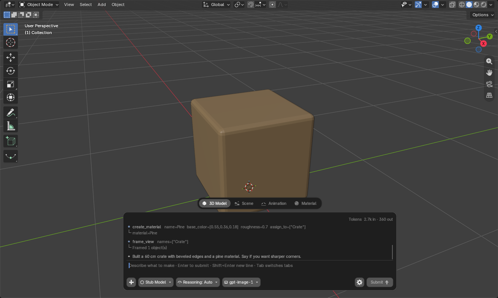
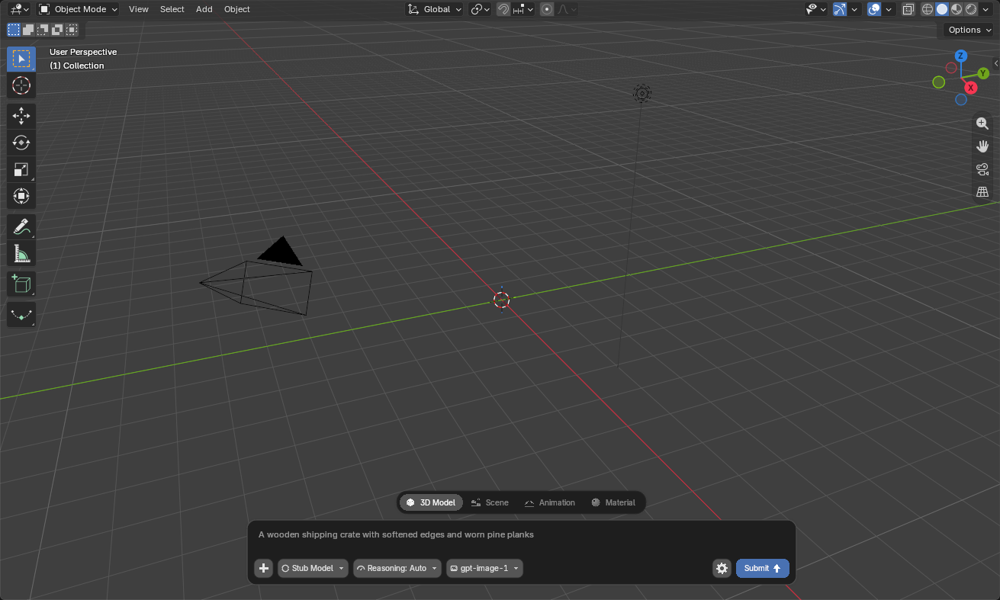
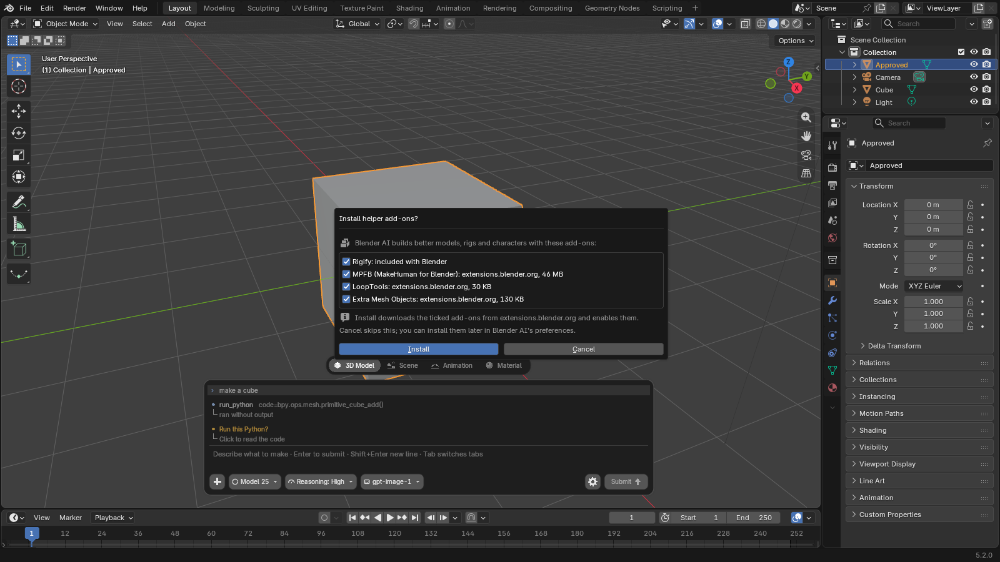
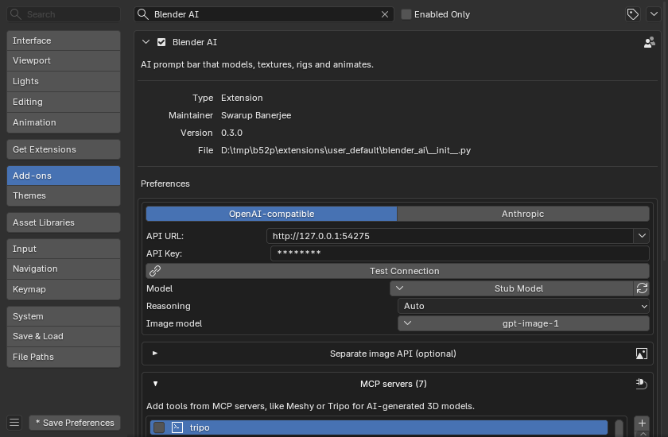
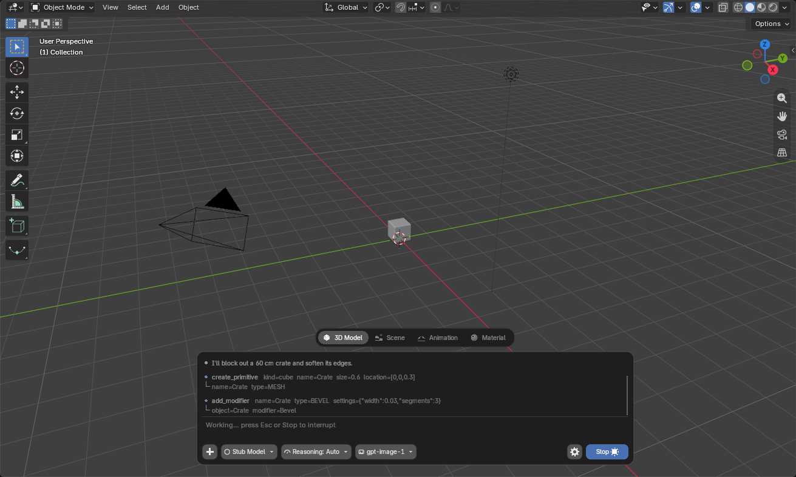
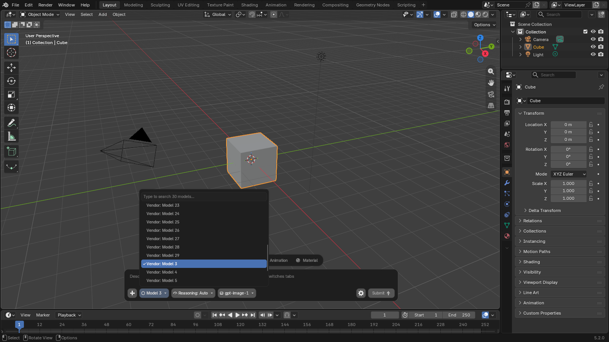
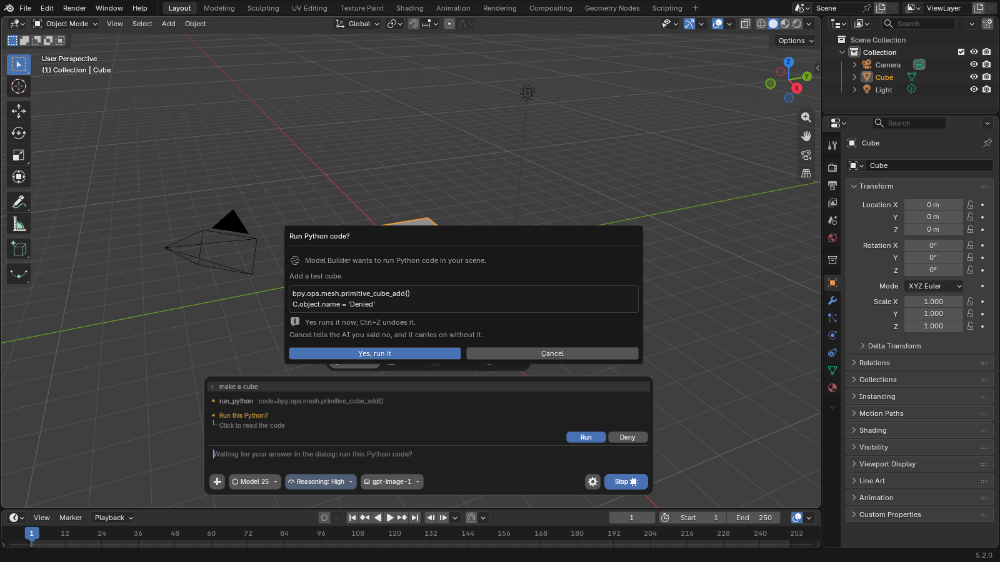

# Blender AI

[](https://github.com/dev-swarup/Blender-AI/actions/workflows/ci.yml)
[](LICENSE)

A prompt bar for Blender's 3D Viewport. Describe a result and specialist AI agents build it with typed
tools: models, materials and PBR textures, rigs, animation, physics, lighting and cameras. It works with
any OpenAI-compatible provider and with Anthropic.



Blender AI is a free, open-source extension for Blender 4.2 LTS and later. Each tab of the bar is an
agent with its own instructions and toolset, and the tabs share one conversation, so follow-ups keep
their context. Agents call high-level tools, fall back to full `bpy` Python, use any MCP servers you
connect, and delegate self-contained parts of a job to sub-agents that run in parallel. Every step is logged as it happens, every step is a single undo, and
agents inspect the viewport to verify their own work.

The screenshots in this document are produced by `tests/ui_smoke.py` against a scripted local API, so the
step logs show scripted replies rather than live model output.

## Contents

- [Features](#features)
- [Requirements](#requirements)
- [Installation](#installation)
- [Updating](#updating)
- [Configuration](#configuration)
- [Usage](#usage)
- [Agents and sub-agents](#agents-and-sub-agents)
- [MCP servers](#mcp-servers)
- [Textures and image models](#textures-and-image-models)
- [Python execution](#python-execution)
- [Settings](#settings)
- [Security and privacy](#security-and-privacy)
- [Troubleshooting](#troubleshooting)
- [Development](#development)
- [License](#license)

## Features

- **Provider-agnostic.** Choose **OpenAI-compatible** (OpenAI, OpenRouter, Gemini, Groq, DeepSeek, xAI,
  Mistral, Together, Ollama, LM Studio, LiteLLM, vLLM and others) or **Anthropic**. You supply a URL and
  a key. The OpenAI-compatible agent runs on the OpenAI Agents SDK; the Anthropic agent runs on the
  Anthropic SDK with extended thinking and prompt caching.
- **Models from your API.** The model and image-model pickers list what your provider's `/models`
  endpoint returns, with search. Nothing is hard-coded.
- **Four specialist agents.** Model Builder, Scene Builder, Animator and Material Generator, each with
  its own instructions and tools, sharing one conversation.
- **Follow-ups keep their context.** Build something, then ask for a change ("taller legs", "make it oak")
  in any tab. Long conversations are summarized automatically when they near the model's context window.
- **Parallel sub-agents.** An agent can hand independent parts of a job to other specialists that work
  at the same time, for example one Model Builder per house in a village.
- **Native-looking UI.** Tabs, a chat and a multi-line prompt in one bar, model, reasoning and image-model
  dropdowns, and a Submit button. Colors, rounding and sizes follow your Blender theme and UI scale.
- **High-level tools.** Whole jobs in one call: scattering with geometry nodes, rigid-body and cloth
  physics, curves and 3D text, Rigify rigs, walk cycles, camera moves, PBR materials. Anything else
  falls back to Python with full `bpy` access.
- **MCP client.** Connect services such as Meshy or Tripo; their tools appear beside the built-in ones.
- **PBR textures.** A seamless base color from your image model; normal, roughness, height, AO and
  metallic maps are derived locally and wired into a Principled BSDF.
- **Self-contained files.** Generated and imported textures are packed into the `.blend`.
- **Light on startup.** A small part loads with Blender; the rest loads in the background.
- **Helper add-ons.** Offers to install Rigify, MPFB, LoopTools and Extra Mesh Objects in one click.



## Requirements

- Blender 4.2 LTS or later (Windows x64, macOS Apple silicon or Intel, Linux x64)
- Blender's **Allow Online Access** enabled (*Edit ▸ Preferences ▸ System ▸ Network*)
- An API key for an AI provider that supports tool calling, or a local server such as Ollama

All Python dependencies are bundled in the extension. Nothing is installed into your system Python.

## Installation

The extension ships as a single zip for every platform; Blender unpacks only the files your system
needs. There are two ways to install it. Use the repository method if you want Blender to deliver
updates.

### Recommended: add the repository

1. Open *Edit ▸ Preferences ▸ Get Extensions*.
2. Open the dropdown at the top right, choose **Repositories**, click **+** and choose
   **Add Remote Repository**.
3. Paste this URL, tick **Check for Updates on Startup**, and confirm:

   ```text
   https://github.com/dev-swarup/Blender-AI/releases/latest/download/index.json
   ```

4. Search for **Blender AI** in *Get Extensions* and click **Install**.

Blender now treats Blender AI like any extension from extensions.blender.org. See [Updating](#updating).

### Alternative: install from a zip

Download `blender_ai-<version>.zip` from the [latest release](https://github.com/dev-swarup/Blender-AI/releases/latest)
and drag it onto an open Blender window, or use *Get Extensions ▸ ⌄ ▸ Install from Disk…*. Extensions
installed from disk go to a local repository, which Blender never checks for updates; install a newer zip
over it to upgrade.

### First start

With online access on, Blender AI asks once whether to install its helper add-ons: Rigify (included with
Blender), MPFB, LoopTools and Extra Mesh Objects. They are downloaded through Blender's own extension
system from extensions.blender.org (about 46 MB, mostly MPFB). Untick any you don't want, then click
**Install**. You can skip the prompt and install them later from the add-on's preferences.



## Updating

When the repository is added with **Check for Updates on Startup**, Blender checks for new releases when
it starts and shows a notification in the status bar if one is available. Open *Get Extensions*, then
use **Update** next to Blender AI or **Update All**. To check on demand, use **Refresh Remote** (the
sync icon) in the same editor.

Each release publishes an `index.json` listing next to the zip. The repository URL above always resolves
to the latest release, so nothing needs to change on your side. Pre-releases are never offered.

## Configuration

1. Open the settings: click the **gear** on the prompt bar, then **All Settings…**
2. Choose **OpenAI-compatible** or **Anthropic**.
3. Pick your provider from the **⌄** next to *API URL*, or paste a URL, then paste your **API key** and
   click **Test Connection**. The model list loads and a model is selected for you; change it any time
   from the bar.



| Provider | API URL | Notes |
|---|---|---|
| OpenAI | `https://api.openai.com/v1` | Chat and image models with one key |
| OpenRouter | `https://openrouter.ai/api/v1` | Many chat and image models with one key |
| Google Gemini | `https://generativelanguage.googleapis.com/v1beta/openai` | |
| Groq, DeepSeek, xAI, Mistral, Together | in the **⌄** list | |
| Ollama / LM Studio (local) | `http://localhost:11434/v1` / `http://localhost:1234/v1` | No key needed; use a model with tool support |
| Anthropic | `https://api.anthropic.com` | Choose the **Anthropic** provider; add a separate image API for textures |

The model must support **tool calling**. Most current models do.

## Usage

Press **Ctrl+Space** in the 3D Viewport (or click the bar), type a request, and press **Enter** or click
**Submit**.

| Tab | Example |
|---|---|
| 3D Model | `A wooden crate with worn PBR planks and metal corner brackets` |
| Scene | `A forest clearing with scattered rocks and trees, sunset light, camera at eye level` |
| Animation | `Rig this character with Rigify and make it walk in a circle` |
| Material | `Make the floor polished concrete with subtle cracks` |

The conversation appears inside the bar, above the text you type, as a compact chat: three lines tall
when idle and six while you type or an agent works, so the model stays in view (click the chat's
background for a taller view). It shows your messages, the agent's replies, a *Thinking…* line while it
reasons, and each tool call with its result on the line below. Sub-agents fold into one line with their
step count. Scroll it with the mouse wheel; while you read older lines it stays put, and **Latest** jumps
back to the end. Click a line to expand it (a tool's full input and result, the reasoning, or a
sub-agent's steps). The top line shows the tokens used so far. Press **Esc** or **Stop** to interrupt.
Every step is one undo step.

Keep talking in the same conversation: after a build, ask for changes ("make the legs taller", "now a
matching table") and the agent edits what it made. The four tabs share the conversation, so you can
build in **3D Model** and texture in **Material** without repeating yourself. Each message also carries a
fresh scene summary, so the agent notices what you changed by hand. When the conversation nears the
model's context window, earlier turns are summarized automatically and the chat says so. **New
Conversation** in the sidebar starts over.



| Control | Function |
|---|---|
| Tabs | Select the agent. The tabs share one conversation. |
| **+** | Attach a reference image (click again to remove). Texture tools can use it. |
| Model | Pick the AI model. Type to filter the list from your API; ↑/↓ and Enter also work. |
| Reasoning | Auto plus the model's effort levels (Off, Minimal, Low, Medium, High, Extra high, Max). Auto uses the model's default. Levels come from your API's model list when it gives them; otherwise from the model family (GPT-5, Claude), or Low / Medium / High. Hidden when the list says the model doesn't reason. A level the API rejects is dropped for that model, and the chat says which one it used instead. |
| Image model | The model used for generated textures. |
| ⚙ | Quick settings: provider, models, viewport screenshots, Python confirmation, *All Settings…* |
| Submit / Stop | Send the request, or stop it while it runs. |



| Key (while typing) | Action |
|---|---|
| Enter / Shift+Enter | Submit / new line |
| Esc or Ctrl+Space | Leave the bar |
| Tab | Next tab |
| ↑ / ↓ | Move between lines, then through earlier prompts |
| Ctrl+V / Ctrl+C / Ctrl+X | Paste / copy all / cut all |

Viewport navigation keeps working while the bar is focused, and Blender shortcuts with Ctrl or Alt
(Ctrl+S, Ctrl+Z, F12 and so on) pass through. The **Blender AI** tab in the sidebar (**N**) shows the
full step log, token usage, and buttons for a new conversation and settings.

## Agents and sub-agents

| Tab | Agent | Scope |
|---|---|---|
| 3D Model | Model Builder | Props, vehicles, buildings, character bodies, game-map pieces: blockout, detail passes, bevels, UVs, materials |
| Scene | Scene Builder | Layout, terrain, scattering, lighting, camera, world |
| Animation | Animator | Rigs, keyframes, walk cycles, NLA, camera moves, physics |
| Material | Material Generator | PBR textures from an image model or a photo, procedural and layered shaders |

Each agent has the tools for its job plus full Python. When a request splits into independent pieces,
the agent calls `spawn_agents`: every sub-agent receives a complete brief, its own collection to build
in and a fresh context, and they work concurrently in the same scene. Their steps appear in the log
prefixed with the task name (`House › create_primitive`), and the parent agent checks and assembles the
results. Stop (Esc) stops all of them.

Limits: four sub-agents at once, two levels deep, 16 per request. While sub-agents run, the AI cannot use
undo, since it would revert everyone's steps; your own Ctrl+Z still works.

## MCP servers

MCP servers add tools from other services. Meshy and Tripo, for example, generate 3D models from text or
images; the agent calls them and imports the result with `import_from_url`.

1. Find the service's **MCP configuration**, the JSON block with `"mcpServers"` published for Claude
   Desktop, Cursor or VS Code, and copy it.
2. In Blender AI settings, open **MCP servers** and click **Paste JSON config**, or click **+** and enter
   a command (for example `uvx some-mcp-server`) or a URL for hosted servers.
3. Provide the API key where the config expects it (usually *Keys / environment*, for example
   `MESHY_API_KEY=…`) and click **Connect**. Each server reports *connected · N tools* or its error.

New MCP tools are available from the next **New Conversation**. Servers launched with `npx` or `uvx`
need Node.js or uv on your machine.

## Textures and image models

`generate_texture` asks your image model for a seamless, flat-lit surface, derives the remaining PBR maps
locally and builds the material. With an OpenAI-compatible provider the image model comes from the same
API (select it on the bar). With Anthropic, or to use another image service, fill in **Separate image
API** in settings. `reference_to_pbr` turns your own photo into a material without any API call. Objects
need UVs; the agent unwraps them first.

## Python execution

Agents can run Python inside Blender with full access, like the Python console. They use it for geometry
nodes, procedural meshes, bulk edits and anything the tools don't cover. Each run is one undo step.

To review scripts before they run, enable **Ask before running Python** (in the ⚙ popover or settings).
A dialog then shows which agent is asking, what the script is for and its code, with **Yes, run it** and
**Cancel**. Cancel tells the agent you declined.



## Settings

The essentials are provider, URL, key and model. Everything else has defaults under **More options**.

| Setting | Default | Notes |
|---|---|---|
| Ask before running Python | Off | Shows each script and waits for approval |
| Let the AI see the viewport | On | Sends a screenshot after steps that change the scene |
| Max steps | 60 | Model turns per request before it pauses; send a message to continue |
| Pack textures into the .blend | On | Stores generated and imported images inside the file |
| Texture folder / Normal maps | extension folder / OpenGL | |
| Refusal fallback | On | Anthropic first-party API only |
| Prompt bar shortcut | Ctrl+Space | Rebindable |

**Helper add-ons** lists Rigify, MPFB, LoopTools and Extra Mesh Objects with their status;
**Install helper add-ons** opens the same list, where you tick the ones to install.

Environment variables `OPENAI_API_KEY`, `OPENAI_BASE_URL`, `ANTHROPIC_API_KEY` and `ANTHROPIC_BASE_URL`
are used as fallbacks. The complete tool reference is in [docs/tools.md](docs/tools.md).

## Security and privacy

- **Data sent.** Prompts, a short text summary of the scene, tool results, viewport screenshots (if
  enabled) and attached images go to your AI provider. Texture prompts and reference images go to your
  image API. Nothing is sent while Blender's online access is off. Tracing in the OpenAI Agents SDK is
  disabled, so runs are never uploaded to OpenAI's dashboard.
- **Keys** are stored in plain text in your Blender preferences and never in `.blend` files. Use the
  environment variables if you prefer not to store them.
- **Python** written by an agent runs with your user's permissions, like any script in Blender. Enable
  *Ask before running Python* to approve each one.
- **MCP servers** are programs or services you choose to connect; command servers run on your computer.
  Add only servers you trust.
- **Helper add-ons** are installed only when you click **Install**, through Blender's extension system
  from extensions.blender.org.

To report a vulnerability, see [SECURITY.md](SECURITY.md).

## Troubleshooting

| Problem | Fix |
|---|---|
| "Online access is off" | *Preferences ▸ System ▸ Network ▸ Allow Online Access* |
| "The API key was rejected" or "Not found" | Check key and URL with **Test Connection**; select the provider from the **⌄** list |
| The model list is empty | Click **↻** next to Model; some local servers list models only while one is loaded |
| "Doesn't support tools", or the AI only chats | Select a model with tool or function calling |
| "This model doesn't accept images" | Screenshots are turned off for that model automatically; send again |
| An MCP server shows *failed* | Read the message and the log it names; check the command, Node.js or uv, and the key |
| Ctrl+Space no longer maximizes the 3D View | Rebind it under *More options*, or use Ctrl+Alt+Space for fullscreen |
| Install fails on Windows with a very long path | Enable Win32 long paths (`LongPathsEnabled`) or use a shorter Blender config folder |
| Textures look stretched | The object needs UVs; ask the agent to unwrap it |
| No update is offered | Confirm the repository was added with the URL above and refresh it; extensions installed from disk are never updated |

## Development

```bash
pip install uv
python scripts/vendor_wheels.py
python scripts/build.py
```

`vendor_wheels.py` resolves and downloads the wheels for every platform into `src/wheels/`, and
`build.py` writes `dist/blender_ai-<version>.zip` with Blender's extension builder. It locates Blender
automatically, or takes `--blender PATH` or the `BLENDER` environment variable. Passing `--download-url`
also writes the `dist/index.json` repository listing that releases publish.

Tests: `pytest` covers the pure-Python parts and both SDKs against local stub servers;
`blender -b --factory-startup --python tests/run_tools.py` exercises every tool; and
`blender --enable-event-simulate --python tests/ui_interactions.py` drives the bar in a real window.
[CONTRIBUTING.md](CONTRIBUTING.md) has the details, including how to run them in an empty profile, and
[docs/architecture.md](docs/architecture.md) describes how the pieces fit together. Issues and pull
requests are welcome.

## License

[GPL-3.0-or-later](LICENSE), as required for Blender extensions.
